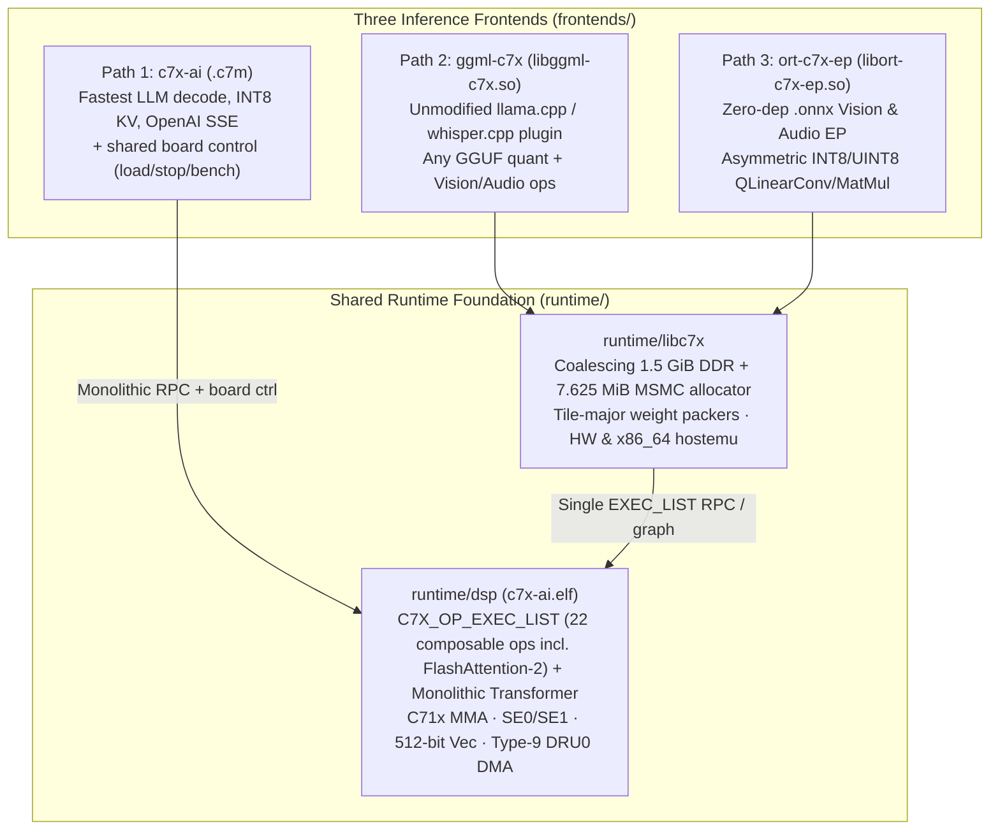
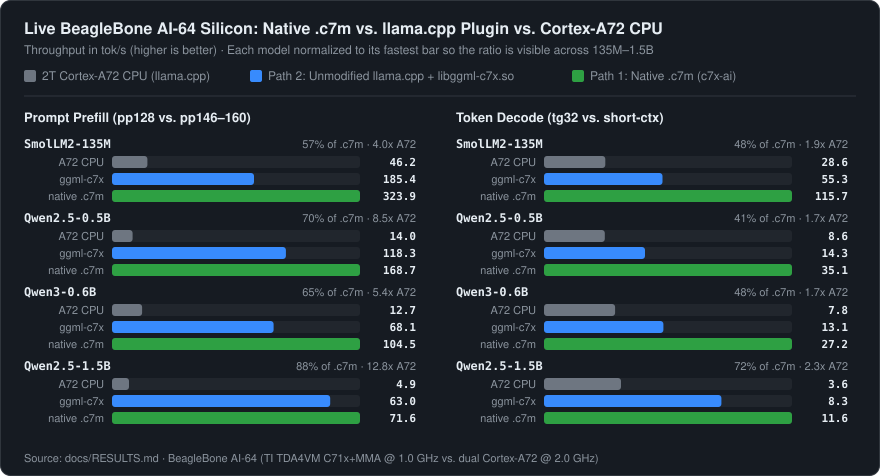
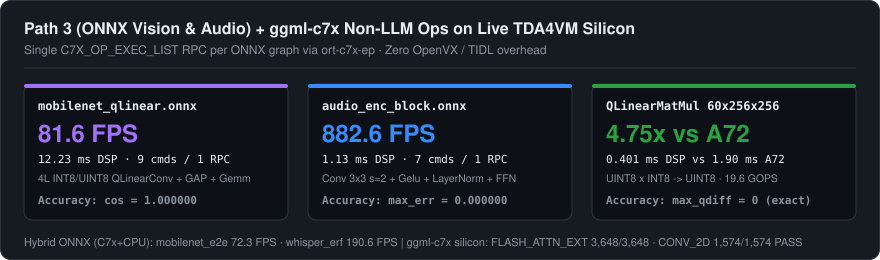

# BeagleBone AI-64 C7x AI Runtimes

Bare-metal **TI C71x DSP + Matrix Multiply Accelerator (MMA)** AI runtimes for the **BeagleBone AI-64 (TDA4VM / J721E)** — driving the 1.0 GHz C7x MMA, Streaming Engines (`SE0`/`SE1`), 512-bit vector unit, 448 KiB L2 SRAM, 7.625 MiB on-chip MSMC SRAM, and bare-metal Type-9 `DRU0` DMA directly with **zero OpenVX, zero TIDL, and zero RTOS overhead**.

One shared bare-metal firmware (`c7x-ai.elf`) and host runtime (`libc7x`) power **three distinct ways to run models**—so you can pick peak decode speed, standard `llama.cpp` GGUF convenience, or quantized ONNX vision/audio graphs without leaving the DSP idle or saturating the dual Cortex-A72 Linux cores.

---

## Which Runtime Path Should I Use?

| Path | Role | Model Format | Measured Live Silicon Speed | Advantages | Tradeoffs |
| --- | --- | --- | --- | --- | --- |
| **1. Native `.c7m` (`c7x-ai`)** | **Fastest LLM decode & long context** | Custom `.c7m` (converted from HuggingFace via `tools/convert_hf.py`) | **Up to `13.8×` prefill / `3.8×` decode** vs 2T A72<br>`SmolLM2-135M`: **`323.9` / `115.7 t/s`**<br>`Qwen2.5-1.5B`: **`71.6` / `11.6 t/s`** | Hand-fused L2 SRAM layers, 2K–4K **INT8 KV cache**, MSMC layer pinning (`871 t/s` on `stories15M`), built-in `chat` REPL & OpenAI SSE `serve`, zero GGUF requant loss | Only supports Llama, SmolLM2, Qwen2/2.5, Qwen3, Mistral; requires `.c7m` conversion step |
| **2. `llama.cpp` Plugin (`ggml-c7x`)** | **Most convenient / standard ecosystem** | Stock `.gguf` (`Q4_0`, `Q4_K_M`, `Q5_K`, `Q6_K`, `Q8_0`, `F16`, `F32`) | **Up to `12.8×` prefill / `2.3×` decode** vs 2T A72<br>`SmolLM2-135M`: **`185.4` / `55.3 t/s`** (`-fa on`)<br>`Qwen2.5-1.5B`: **`63.0` / `8.3 t/s`** | Zero-fork dynamic plugin (`/usr/lib/c7x-ai/libggml-c7x.so`); native **FlashAttention-2** (`-fa on`), **`Q8_0` KV cache** (`-ctk q8_0 -ctv q8_0`), peephole op fusion, full `llama.cpp` & `whisper.cpp` ecosystem | `1.4×–2.1×` slower decode than `.c7m` (discrete DDR ops + host logits read); default `W4A8` repacking adds PPL drift (use `GGML_C7X_W8A8=1` for 2.4–10× lower drift at 2× weight RAM) |
| **3. ONNX EP (`ort-c7x-ep`)** | **Vision CNNs & audio encoders** | Standard `.onnx` (INT8/UINT8 `QLinear`, FP32, & hybrid graphs) | `mobilenet_qlinear.onnx`: **`81.6 FPS`** (`12.2 ms`)<br>`mobilenet_e2e_hybrid`: **`72.3 FPS`** (`13.8 ms`)<br>`audio_enc_block.onnx`: **`882.6 FPS`** (`1.13 ms`)<br>`QLinearMatMul`: **`19.6 GOPS` (`4.75×` vs A72)** | Zero-dependency `.onnx` compiler lowering C7x subgraphs into **1 RPC**, optional **hybrid C7x+CPU partitioning** (`allow_cpu_fallback=1`) for `QuantizeLinear`/`Softmax`/erf-`Gelu`, plus ORT C API shim (`OrtSessionOptionsAppendExecutionProvider_C7x`) | CPU fallback covers common pre/post/transformer glue ops (`QuantizeLinear`, `Softmax`, `Gelu`, `Clip`, `Transpose`, `Concat`, `Resize`); exotic ops still fail cleanly |

> **Rule of thumb:** Use **Path 1 (`c7x-ai`)** for maximum LLM speed and 4K-context serving on supported architectures; use **Path 2 (`ggml-c7x`)** to run any off-the-shelf GGUF in stock `llama.cpp`; use **Path 3 (`ort-c7x-ep`)** for quantized vision CNNs and audio blocks. All three run on the **same `c7x-ai.elf` firmware**.

---

## Architecture



---

## Live BeagleBone AI-64 Silicon Benchmarks

<picture>
  <source media="(prefers-color-scheme: dark)" srcset="docs/assets/llm-tradeoff-dark.svg">
  <source media="(prefers-color-scheme: light)" srcset="docs/assets/llm-tradeoff-light.svg">
  
</picture>

<picture>
  <source media="(prefers-color-scheme: dark)" srcset="docs/assets/non-llm-bench-dark.svg">
  <source media="(prefers-color-scheme: light)" srcset="docs/assets/non-llm-bench-light.svg">
  
</picture>

- **Full hardware tables, perplexity comparisons (`W4A8` vs `GGML_C7X_W8A8=1`), and long-context (`4K`) numbers:** [`docs/RESULTS.md`](docs/RESULTS.md)
- **Address map (7.625 MiB MSMC + 1.5 GiB high-DDR arena) & cache rules:** [`docs/MEMORY.md`](docs/MEMORY.md)
- **Emulator-vs-silicon pitfalls & compiler quirks:** [`docs/NOTES.md`](docs/NOTES.md)

---

## Step 0: Build & Flash Shared Board Setup (Required for All 3 Paths)

All toolchains run inside reproducible Podman/Docker containers (`platform/containers/`) — no local TI CGT or aarch64 cross-compiler needed:

```bash
# Build & run all x86_64 host-emulation tests + aarch64 board binaries + DT overlay
./platform/beagle-linux/scripts/build.sh all
./platform/beagle-linux/scripts/build.sh bundle

# Deploy to the BeagleBone AI-64
scp -r out/c7x-ai-beagle USER@BOARD:
ssh -t USER@BOARD 'sudo ./c7x-ai-beagle/install-beagle.sh && sudo reboot'

# After reboot, load the shared C7x firmware and verify silicon health
ssh USER@BOARD 'c7x-ai load c7x-ai.elf && c7x-ai status && c7x-ai bench all'
```

*(Individual build targets: `host-test`, `dsp`, `libc7x`, `ggml`, `ort`, `linux`, `overlay`, `bundle`.)*

---

## Quick Starts by Runtime Path

### Path 1: Fastest Native LLM Runtime (`frontends/c7x-ai/`)

Converts any supported HuggingFace model (`Llama`, `SmolLM2`, `Qwen2/2.5`, `Qwen3`, `Mistral`) directly into native `W4A8-g64` `.c7m` (stdlib HTTP + NumPy only) and runs with hand-fused L2 layers and optional INT8 KV cache:

```bash
# On PC: download from HuggingFace Hub and pack to native W4A8-g64 .c7m
python3 tools/convert_hf.py --repo Qwen/Qwen2.5-1.5B-Instruct \
    --out models/qwen2.5-1.5b-w4a8.c7m --quant w4a8 --seq-len 2048
scp models/qwen2.5-1.5b-w4a8.c7m USER@BOARD:/tmp/

# On BeagleBone AI-64: inspect, interactive chat, or OpenAI HTTP/1.1 + SSE API
c7x-ai llama info /tmp/qwen2.5-1.5b-w4a8.c7m
c7x-ai llama chat /tmp/qwen2.5-1.5b-w4a8.c7m -t 0.7 -P 0.9
c7x-ai serve /tmp/qwen2.5-1.5b-w4a8.c7m --host 0.0.0.0 --port 8080
```

See [`frontends/c7x-ai/README.md`](frontends/c7x-ai/README.md) for all CLI commands, speculative decoding, and `curl` examples.

### Path 2: Unmodified `llama.cpp` Dynamic Backend (`frontends/ggml-c7x/`)

`install-beagle.sh` installs `/usr/lib/c7x-ai/libggml-c7x.so` directly onto the board. Build upstream `llama.cpp` with `-DBUILD_SHARED_LIBS=ON -DGGML_BACKEND_DL=ON` (zero patches to `llama.cpp`) and point `GGML_BACKEND_PATH` at it:

```bash
# On BeagleBone AI-64 (after `c7x-ai load c7x-ai.elf`):
GGML_BACKEND_PATH=/usr/lib/c7x-ai/libggml-c7x.so llama-bench --list-devices
GGML_BACKEND_PATH=/usr/lib/c7x-ai/libggml-c7x.so llama-completion -m model-Q4_0.gguf -ngl 99 -p "Hello"

# Optional 2x smaller Q8_0 KV cache (native C7x FlashAttention-2):
GGML_BACKEND_PATH=/usr/lib/c7x-ai/libggml-c7x.so llama-completion -m model-Q4_0.gguf -ngl 99 -fa on -ctk q8_0 -ctv q8_0 -p "Hello"

# Optional higher-accuracy W8A8 repacking (cuts Q4_0/Q4_K PPL delta by 2.4–10x at 2x weight RAM):
GGML_C7X_W8A8=1 GGML_BACKEND_PATH=/usr/lib/c7x-ai/libggml-c7x.so llama-completion -m model-Q4_K_M.gguf -ngl 99 -p "Hello"
```

See [`frontends/ggml-c7x/README.md`](frontends/ggml-c7x/README.md) for supported ops, Vision/Audio (`whisper.cpp`) ops, and environment flags.

### Path 3: ONNX Vision & Audio Execution Provider (`frontends/ort-c7x-ep/`)

`install-beagle.sh` installs `/usr/lib/c7x-ai/libort-c7x-ep.so`, `/usr/lib/c7x-ai/test_ort_c7x_ep`, and all four ONNX verification models (`mobilenet_qlinear`, `audio_enc_block`, `mobilenet_e2e_hybrid`, `whisper_erf_hybrid`) into `/usr/share/c7x-ai/models/`:

```bash
# On BeagleBone AI-64 (after `c7x-ai load c7x-ai.elf`):
/usr/lib/c7x-ai/test_ort_c7x_ep /usr/share/c7x-ai/models 20
```

See [`frontends/ort-c7x-ep/README.md`](frontends/ort-c7x-ep/README.md) for the C API, hybrid C7x+CPU subgraph partitioning (`allow_cpu_fallback = 1`), and the ONNX Runtime C API shim (`OrtSessionOptionsAppendExecutionProvider_C7x`).

---

## Repository Layout

The directory tree mirrors the layered architecture directly:

```text
runtime/                      Shared bare-metal DSP + host C runtime
├── dsp/                      TI C71x+MMA firmware (c7x-ai.elf) & x86_64 host-emulation tests
└── libc7x/                   Reusable host C library (DDR/MSMC allocator, packers, HW + hostemu)

frontends/                    Three ways to run models on top of runtime/
├── c7x-ai/                   Path 1: Native CLI (board control + fastest .c7m LLM chat/serve)
├── ggml-c7x/                 Path 2: Dynamic llama.cpp / whisper.cpp backend (libggml-c7x.so)
└── ort-c7x-ep/               Path 3: Zero-dependency ONNX Vision & Audio EP (libort-c7x-ep.so)

platform/                     Board packaging, OS images & reproducible toolchains
├── beagle-linux/             Containerized build.sh, board install-beagle.sh, 1.5 GiB DDR DT overlay
├── containers/               Podman/Docker images (TI C7000 CGT 1.2.0.STS + Debian aarch64)
└── yocto/                    Minimal Poky Linux 6.18 kas + meta-ai64 layer

tools/                        HuggingFace converter (convert_hf.py), Python ref, SVG chart generator
docs/                         MEMORY.md, NOTES.md, RESULTS.md, and docs/assets/*.svg
```

---

## Credits & License

Originally forked from [`BeagleBoneAI64-linux-zephyr-pru-c7x-c66x-demo`](https://github.com/kevinacahalan/BeagleBoneAI64-linux-zephyr-pru-c7x-c66x-demo).

MIT — see [`LICENSE`](LICENSE).
